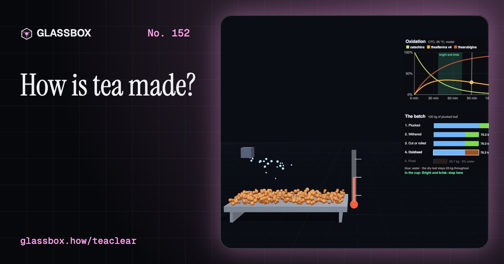
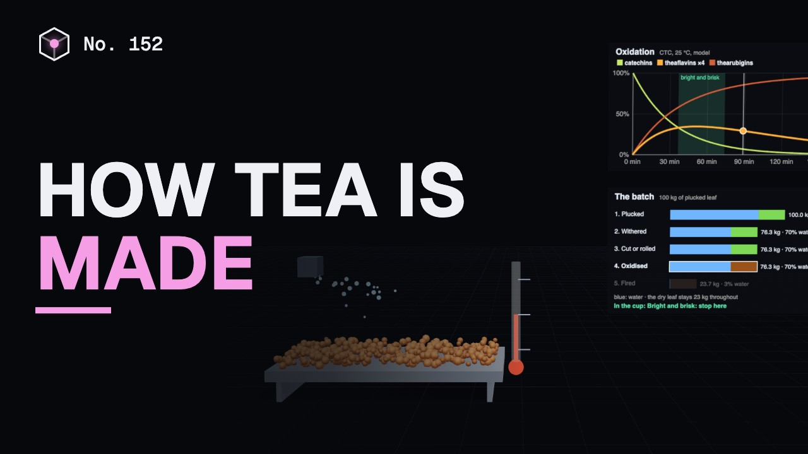
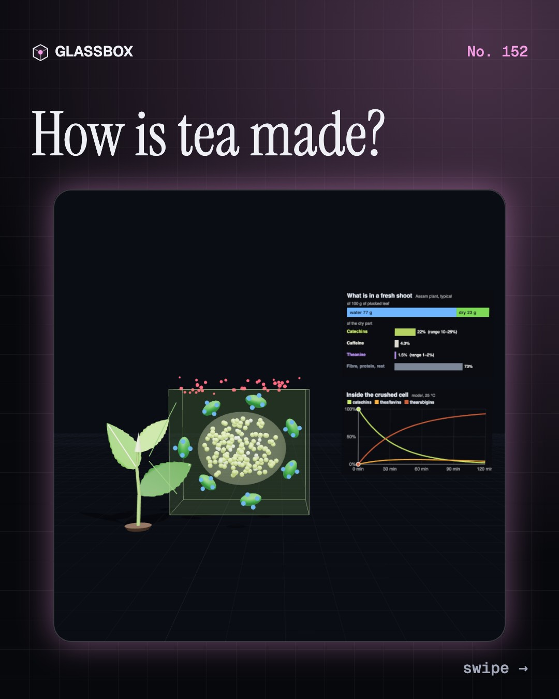
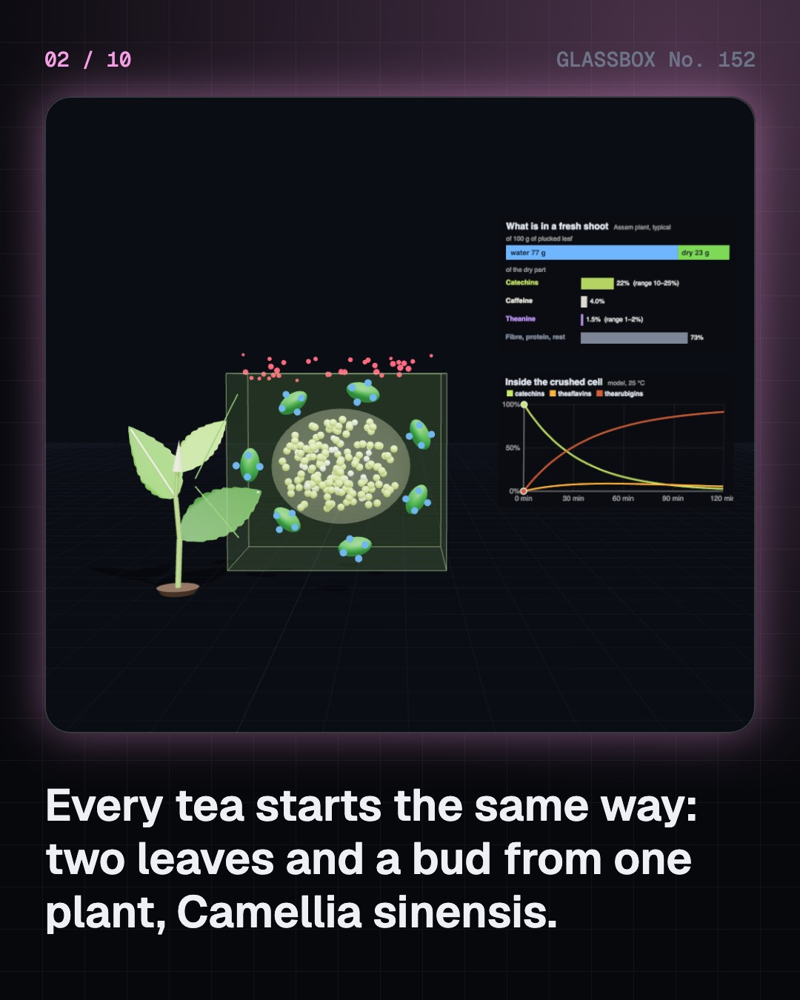
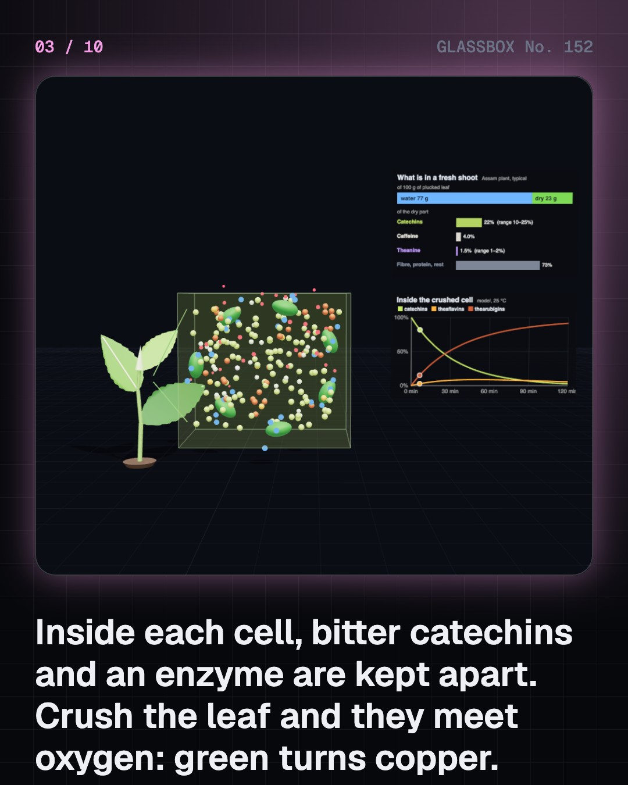
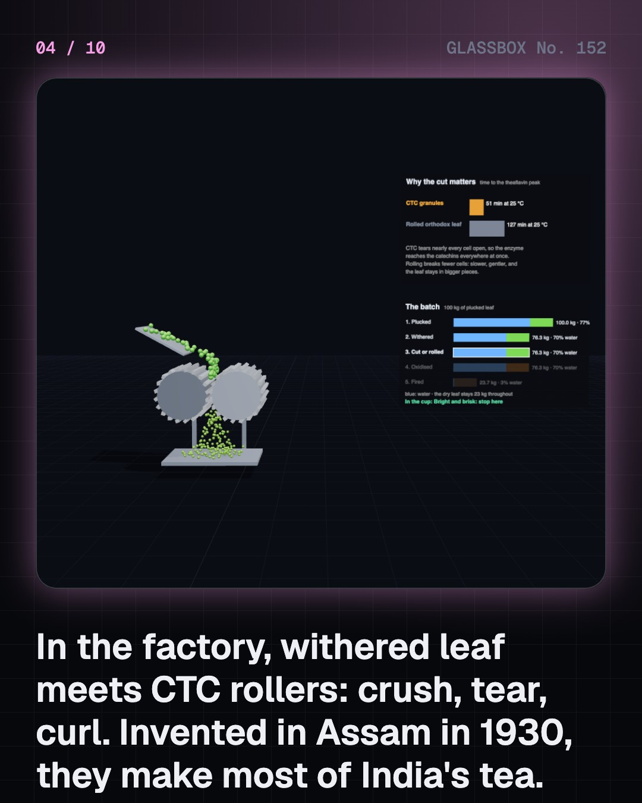

<!-- glassbox:start -->
<!-- Generated from glassbox.json by the Glassbox hub (npm run readme -- teaclear). Edit glassbox.json, not this block. -->
<p align="center"><a href="https://glassbox.how/e/teaclear/"></a></p>

<h1 align="center">TeaClear</h1>

<p align="center"><b>How is tea made?</b><br>Green tea and black tea are the same leaf. Crush it and an enzyme turns it copper in an hour; heat it first and it stays green. Run the factory, stop the oxidation at the right minute, then brew it: caffeine rushes out first, the bitter tannins keep coming, and a pan of chai shows why milk makes it smooth.</p>

<p align="center"><a href="https://glassbox.how/teaclear/"><b>▶ Play with it</b></a> &nbsp;·&nbsp; <a href="https://glassbox.how/e/teaclear/">Read the 60-second explainer</a> &nbsp;·&nbsp; <a href="https://glassbox.how/teaclear/glassbox/reel.mp4">Watch the 40-second video</a></p>

<p align="center">
  <a href="https://glassbox.how/e/teaclear/"></a>
  <a href="https://glassbox.how/e/teaclear/"></a>
  <a href="LICENSE"></a>
  <a href="LICENSE-CONTENT.md"></a>
  <a href="#privacy"></a>
</p>

## In 60 seconds

1. **One plant, kept in two rooms.** All tea comes from Camellia sinensis. Pluckers take two leaves and a bud. In each cell the bitter catechins sit in the vacuole and the enzyme polyphenol oxidase sits in the chloroplasts, so a living leaf stays green.
2. **The factory breaks the wall.** The leaf is withered from about 77% water to about 70%, then rolled or cut by CTC rollers so the cells tear. Catechins, enzyme and oxygen meet and the leaf oxidises: orange theaflavins rise, then red-brown thearubigins. Hot air then dries it to about 3% water and kills the enzyme. About 100 kg of leaf makes 23.7 kg of tea.
3. **Six teas from one leaf.** Heat the leaf first and the enzyme dies: green tea. Oxidise it all the way: black tea. Stop halfway: oolong. Only wither and dry it: white. Wrap a green tea warm and damp: yellow. Pile it damp with microbes for weeks: dark tea, the only one that is truly fermented.
4. **The brew is a race.** Caffeine is small and leaves the leaf fast: half is out of whole black leaf in under two minutes at 80 °C (measured). Tannins are bigger, come out more slowly and keep coming, so a long brew adds bitterness, not much caffeine. Hotter water and smaller leaf speed everything up.
5. **Why chai is boiled with milk.** CTC granules in boiling water give up nearly all their caffeine within a minute and their tannins soon after. Casein, the main milk protein, binds tannins, so fewer are left to dry your mouth. Sugar covers the rest. A strong Assam CTC can take the boiling and the milk.
6. **India's cup, and yours.** India made about 1,285 million kg of tea in 2024, half of it in Assam, and drinks about four fifths of it. ICMR-NIN advises keeping caffeine within 300 mg a day and tea an hour away from meals, because tannins hinder iron absorption. IARC classes drinks above 65 °C as probably carcinogenic, so let the cup cool.

## Words worth knowing

| Term | Meaning |
|---|---|
| **Camellia sinensis** | The tea plant. Every true tea, from green to black, is made from its leaves and buds. |
| **Catechins** | The bitter, astringent polyphenols of the fresh leaf, 10 to 25% of its dry weight. EGCG is the most abundant. |
| **Polyphenol oxidase** | The leaf's own enzyme that joins catechins with oxygen once the cells are broken. Heat destroys it. |
| **Oxidation** | The enzyme-driven browning of crushed tea leaf in air. The tea trade calls it fermentation, but no microbes are involved. |
| **Theaflavins and thearubigins** | The orange and red-brown molecules made from catechins during oxidation. They give black tea its brightness, colour and body. |
| **CTC** | Crush, tear, curl: toothed rollers that shred withered leaf into granules that brew fast and strong. First used in Assam in 1930. |
| **Fixing** | Heating fresh leaf in a pan or in steam to kill the enzyme. It is what keeps green tea green. |
| **Extraction** | Molecules moving out of the swollen leaf into hot water. Caffeine leaves fast; tannins follow more slowly. |
| **Astringency** | The dry, puckering feeling when tannins grip the proteins in your saliva. Milk protein softens it by binding the tannins first. |

## A short history

**From a wild leaf in the hills where China, Myanmar and Assam meet to a billion cups of chai a day.**

- **760** · Lu Yu writes The Classic of Tea (Lu Yu, Tang dynasty China)
- **1610** · Dutch ships carry tea towards Europe (Dutch East India Company, Macao, Hirado and Amsterdam)
- **1823** · Assam's own tea plant is shown to the British (Robert Bruce, Maniram Dewan and the Singpho chief Bessa Gam, Upper Assam)
- **1839** · The first Assam tea is sold in London (The Tea Committee and the Assam Company, Chabua, Assam, and London)
- **1863** · Indentured labour and its cost (Recruited workers of the Assam gardens, Assam)
- **1903** · A campaign teaches India to drink tea (Tea Cess Committee and Indian Tea Association, Railways, mills and bazaars of India)
- **1908** · The tea bag (Roberta Lawson and Mary McLaren; Thomas Sullivan, Milwaukee and New York, USA)
- **1930** · CTC: crush, tear, curl (William McKercher, Amgoorie tea garden, Assam)

The full story, with 30 moments, charts, people and 39 sources: [glassbox.how/e/teaclear/history](https://glassbox.how/e/teaclear/history/). The data lives in [`history.json`](history.json).

## Video and slides

Made with the Glassbox studio from this box's storyboard (`window.glassbox.director`). Free to reuse under CC BY 4.0.

<a href="https://glassbox.how/teaclear/glassbox/video.mp4"></a>

<p><a href="glassbox/slide-1.jpg"></a> <a href="glassbox/slide-2.jpg"></a> <a href="glassbox/slide-3.jpg"></a> <a href="glassbox/slide-4.jpg"></a></p>

| File | What | Size |
|---|---|---|
| [`glassbox/reel.mp4`](https://glassbox.how/teaclear/glassbox/reel.mp4) | Reel / Short, with captions and soundtrack | 1080×1920 |
| [`glassbox/video.mp4`](https://glassbox.how/teaclear/glassbox/video.mp4) | YouTube video, with captions and soundtrack | 1920×1080 |
| `glassbox/slide-1…10.jpg` | Instagram carousel | 1080×1350 |
| `glassbox/thumb.jpg` | YouTube thumbnail | 1280×720 |
| `glassbox/cover.jpg` | Share card and repo social preview | 1200×630 |
| [`glassbox/history-reel.mp4`](https://glassbox.how/teaclear/glassbox/history-reel.mp4) | “History in 10 moments” Reel / Short | 1080×1920 |
| `glassbox/history-slide-*.jpg` | History carousel | 1080×1350 |
| `glassbox/post.json` | Post copy and schedule used by the publish kit | |

## Privacy

This box has no accounts and no ads, and it ships its own fonts and libraries. When you run it yourself it sends nothing anywhere. On glassbox.how, the site's `/bar.js` also loads Glassbox's analytics: **Google Analytics** to count visits (it asks first in the EU, UK and Switzerland, and stays off when your browser sends Global Privacy Control or Do Not Track) and **ClickTrust** to detect bots.

It remembers a few things **in your own browser only**, and never sends them anywhere:

| Browser storage key | What it holds |
|---|---|
| `teaclear.v1` | Which chapters you have opened, your best quiz scores, and sound on or off. |

Exactly what each one sees is at [glassbox.how/privacy](https://glassbox.how/privacy/).

## Licences

- **Code:** [MIT](LICENSE). Use it, change it, ship it.
- **Explanations, text, images and videos** (`glassbox.json`, `glassbox/`): [CC BY 4.0](LICENSE-CONTENT.md). Credit “Glassbox, glassbox.how/e/teaclear”.
- **Third-party parts** keep their own licences: [three.js](https://threejs.org) (MIT), [Geist, Instrument Serif](https://openfontlicense.org) (SIL OFL 1.1).
- The Glassbox name and logo aren't covered by either licence. See the [terms](https://glassbox.how/terms/).

Found a mistake? [Open an issue](https://github.com/bdeeps/teaclear/issues). Corrections happen in public.
<!-- glassbox:end -->

## Run it

It's plain HTML, CSS and JavaScript. No build step and no dependencies. Run locally, it contacts no other website.

```bash
python3 -m http.server 8000
```

Three.js and the fonts ship in `vendor/` and `fonts/`, so it also works offline.

Then open http://localhost:8000.

## How it's built

| File | What |
|---|---|
| `index.html`, `css/app.css` | The page and its styles |
| `js/app.js`, `js/stage.js`, `js/ui.js`, `js/kit.js` | The shared Glassbox 3D engine: chapters, 3D stage, controls, quiz, video director |
| `js/chapters/*.js` | One file per chapter: the 3D model, controls, text, key terms, quiz and video scenes |
| `js/tea.js` | Shared tea models: withering and firing mass balance, oxidation kinetics, caffeine and tannin extraction (Spiro's measured rates), official guidance figures, chart boards, cups, leaves and the chai pan |
| `glassbox.json` | Title, question, explainer beats, key terms, browser storage and credits shown on glassbox.how |
| `reel` in each chapter | The storyboard the Glassbox studio records into short videos |
| `glassbox/` | The published video, slides, thumbnail and post copy |
| `fonts/`, `vendor/three/` | Self-hosted Geist and Instrument Serif (SIL OFL 1.1) and three.js (MIT) |
